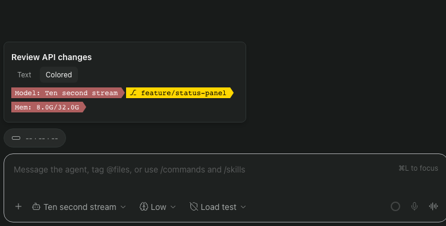
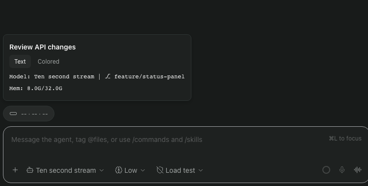
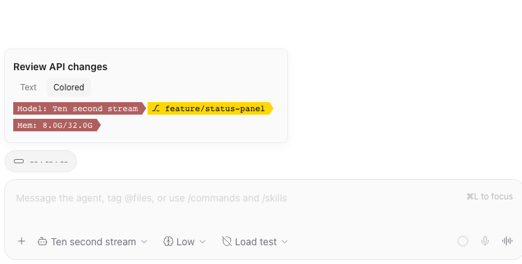
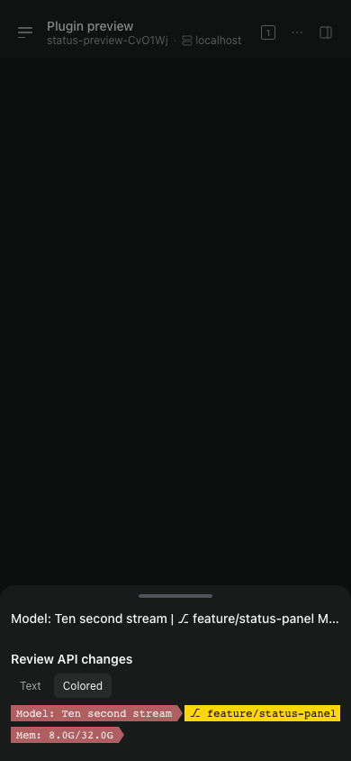

# ccstatusline for Paseo

Your [ccstatusline](https://github.com/sirmalloc/ccstatusline) layout, beside each [Paseo](https://paseo.sh) agent's composer. Check context usage at a glance, then click for model, Git branch, tokens, memory and provider usage in Text or Colored view.



Context and status widgets work with **Paseo 0.14.0**. Account usage requires the proposed agent-scoped usage API in both the daemon and app; it is hidden on older versions. Hover shows a plain-text tooltip; click or tap opens the panel. The selected view is shared across agents until the plugin or app reloads.

## Install

Enable plugins in **Settings → Plugins** on the daemon you want to use, then install from this public repository:

```sh
paseo plugin add git:Laobei2012/paseo-ccstatusline
```

You can also paste `git:Laobei2012/paseo-ccstatusline` into the app's **Plugin source** field. Plugins run as trusted code on your daemon. See [Data access](#data-access) for what this plugin reads.

The marketplace listing is being prepared. Until it is approved, use the Git source above. No npm install or separate plugin build is needed on the daemon.

## Configure

The plugin reads **the daemon machine's** `~/.config/ccstatusline/settings.json`. If you already use ccstatusline there, it reuses your configured rows, colors and Powerline theme. For a remote daemon, changing the file on your laptop will not change that daemon's layout.

To start with a small layout, create that file with:

```json
{
  "lines": [
    [{ "type": "model" }, { "type": "context-bar" }],
    [{ "type": "git-branch" }, { "type": "free-memory" }],
    [{ "type": "session-usage" }, { "type": "weekly-usage" }]
  ],
  "powerline": { "enabled": true, "theme": "nord-aurora" }
}
```

Set `CCSTATUSLINE_SETTINGS_PATH` in the daemon's environment to use another file. Saved changes refresh every 30 seconds and while the panel is open. A missing or invalid file shows an error in the panel.

## Views

| Text | Colored, light theme |
| --- | --- |
|  |  |

The pill reads **context % · 5-hour usage % · weekly usage %**. A missing value appears as `--`. The panel follows your configured row order, omits widgets without data, and lists unsupported widget types below the rows.

Long rows scroll horizontally together. On the web/desktop client, roll the mouse wheel down inside the panel to move right, or up to move left. Horizontal trackpad scrolling also works.

<details>
<summary>Compact layout</summary>



On narrow screens, Paseo opens a sheet. The host can repeat the tooltip text above the panel. This capture verifies the compact web layout; native touch gestures have not been verified.

</details>

Screenshots show the current plugin on a standard Paseo host with a mock agent and sample branch/memory data. That provider has no context or account usage report, so the pill shows `--`. See [capture details](docs/screenshots.md).

## Supported widgets

| Information | Widget types |
| --- | --- |
| Agent | `model`, `context-bar`, `thinking-effort` |
| Workspace and machine | `git-branch`, `current-working-dir`, `free-memory` |
| Tokens | `tokens-cached`, `tokens-input`, `tokens-output` |
| Estimated speed | `input-speed`, `output-speed`, `total-speed` |
| Provider usage | `session-usage`, `reset-timer`, `weekly-usage`, `weekly-reset-timer` |
| Claude-specific | `skills`, `output-style` |

Colored view supports widget `color` and `backgroundColor`, `colorLevel`, `globalBold`, and the built-in Powerline themes and `continueThemeAcrossLines`. This is an adapter for supported ccstatusline widgets, rather than its full terminal renderer.

## Data access

The plugin reads agent metadata, model catalogs and provider usage through Paseo, plus the settings file above. On the daemon it runs `git branch --show-current` in the agent's directory and reads system memory statistics (`vm_stat` on macOS, with an OS memory fallback).

For Claude agents it reads `outputStyle` from project or user Claude settings, and fetches up to 100 recent timeline entries while the panel is open to find the last explicit `Skill` call. It does not read authentication tokens, change Claude settings, send prompts to providers, or make its own external network requests. Status data is sent from the daemon to connected Paseo clients for display; provider usage retrieval is handled by Paseo's configured usage sources.

## Limits and troubleshooting

- **Usage follows the agent account.** Usage requires `agents.ref(id).listUsageReports()` and the daemon’s `agentUsageRevision` capability. These APIs are not yet in a published Paseo release. Older hosts/apps show `--` for account usage. Reports describe account quotas, not consumption by this agent alone. Missing, multiple or unavailable reports hide usage values; there is no fallback to host-wide usage. The account label appears as `Usage: …`.
- **A row is missing.** Rows containing only unavailable values are omitted. There is no four-row limit. Check whether the provider supplies the values and whether the widget is supported.
- **Tokens and speed.** Token counts come from the agent's latest usage snapshot, not accumulated session totals. Speed estimates require changes between reports and are often unavailable.
- **Refresh behavior.** Facts may retain their last good values for five minutes. Usage is cached per host and agent, polled every 60 seconds, and cleared/refetched on launch revision changes, turn starts, reconnects and panel opening. A failed usage refresh clears its values. Settings refresh every 30 seconds. Switching accounts through a plugin must change the agent’s launch revision or continue in another agent; silently replacing credentials inside a running launch is outside this contract.
- **No pill.** Confirm the agent belongs to a workspace and `paseo plugin ls` reports the plugin as `running`. Inspect `paseo plugin logs paseo-ccstatusline` for load errors.
- **Hover is plain text.** Interactive hover controls are unavailable on standard Paseo 0.14.0. Click the pill to select a view.

## Development and release

```sh
npm ci --ignore-scripts
npm run typecheck
npm test
npm pack --dry-run --ignore-scripts
```

Paseo supplies the SDK, React, React Native, TanStack Query and Zod at runtime. Dependencies in this repository are for development; the plugin needs no installation build step.

The development dependencies stay pinned to 0.14.0 until the API ships. `client/agent-usage.ts` contains a temporary optional-method type bridge; it never calls private transport methods. After the upstream release, replace the bridge with the SDK types and raise dependency versions. Keep the manifest minimum at 0.14.0 while older hosts remain supported with account usage hidden. Validate the enabled path against the API branch before release; unit tests alone do not prove a live ZeroSub switch.

See [the release checklist and submission draft](docs/releasing.md). Documents under `docs/superpowers/` record development history, including reverted host API experiments; they are not current installation instructions.

## License

[MIT](LICENSE). Adapted ccstatusline code and its license are recorded in [Third-party notices](THIRD_PARTY_NOTICES.md).
